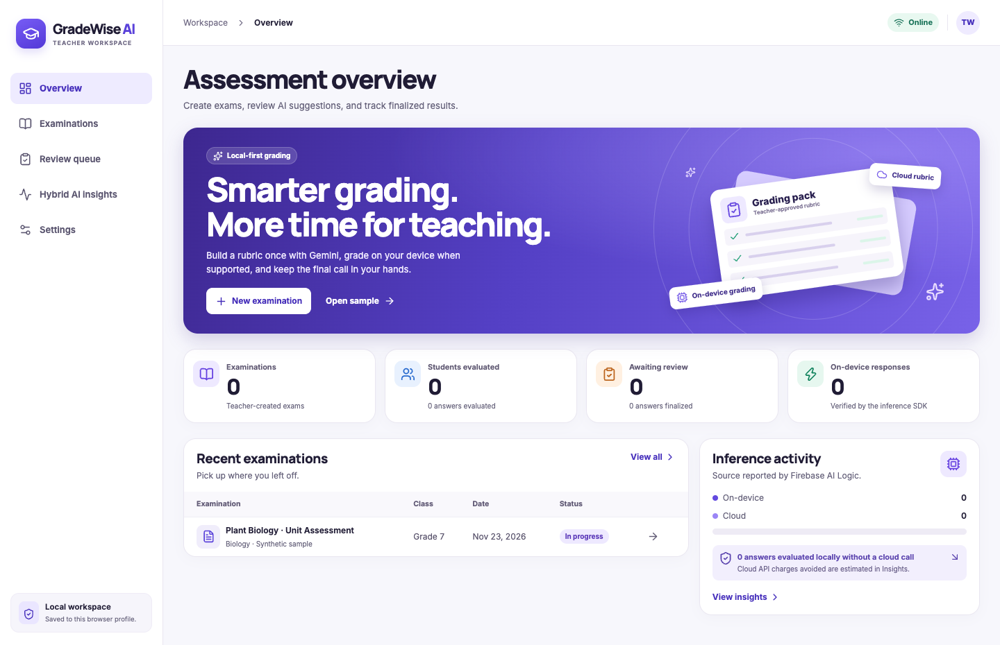

# GradeWise AI

GradeWise AI helps teachers apply an approved marking scheme across an entire class. Cloud Gemini prepares the rubric once. On supported hardware, Firebase AI Logic can grade answers against that rubric on the device, including offline. The app validates evidence and sends unresolved work to cloud only when the teacher permits the transfer. The teacher controls which scores are finalized.



[Verified offline grade](apps/web/screenshots/offline-grade.png) · [Android workspace](apps/android/screenshots/teacher-workspace.png) · [iOS workspace](apps/ios/screenshots/teacher-workspace.png)

[Open the hosted demo](https://gradewise-ai-2026.web.app/)

## Try the teacher workspace

1. Run the web app locally with Node 24.
2. Open **Explore a sample** to explore a synthetic examination with a prewritten rubric and answer papers.
3. Review the rubric, see how evidence and source appear in answer review, and export finalized marks. To try live AI, set up Firebase as described below.

```sh
npm ci
npm run dev
```

The web app uses React, TypeScript, IndexedDB and a service worker. Android uses Kotlin and Jetpack Compose. iOS uses SwiftUI. The clients share versioned JSON contracts and marking prompts. Student records are kept in client storage. The cloud service receives document text for rubric creation or a question and answer for consented grading. The public Spark configuration is intended for synthetic or non-sensitive inputs. [Architecture](docs/ARCHITECTURE.md) · [Privacy and security](docs/SECURITY.md)

## Configure Firebase

1. Create a dedicated Firebase project on Spark and register the web app, Android package `app.gradewise.android`, and Apple bundle `app.gradewise.ios`.
2. In Firebase AI Logic, enable the Gemini Developer API and App Check. Choose a model supported by the project. The model defaults to `gemini-3.5-flash-lite`.
3. Copy [the web environment template](apps/web/.env.example) to `apps/web/.env.local` and add the Firebase web configuration. Register a dedicated reCAPTCHA Enterprise site key for published web hosts and use an explicitly registered App Check debug provider for localhost.
4. Save the app-specific configurations to `apps/android/app/google-services.json` and `apps/ios/GoogleService-Info.plist`. Follow the native instructions to register debug providers and configure release signing and attestation.
5. To run on Chrome desktop, use the settings control to initialize Gemini Nano on supported hardware. Wait for the model download before disconnecting the browser. Native on-device grading requires supported physical hardware.

[Android development](apps/android/README.md) · [iOS development](apps/ios/README.md) · [Firebase setup](docs/DEPLOYMENT.md)

## Run the checks

```sh
npm run typecheck
npm run contracts
npm test
npm run build
npx playwright install chromium
npm run test:e2e --workspace @gradewise/web
npm run test:rules
```

Run `npm run proof` to open the isolated Firebase smoke page at `http://127.0.0.1:4175`. Its buttons exercise the real Firebase on-device and cloud SDK modes on a small synthetic exam. For the automated benchmark, run `npm run benchmark -- device` or `npm run benchmark -- cloud` while the proof server is running. Use `GRADEWISE_KEEP_MODEL=true` for repeated runs in a dedicated, ignored Chrome profile that retains the downloaded model. After the download, `npm run benchmark -- workspace` checks grading, review, and persistence in the production preview on port 4173. Local cloud automation accepts `GRADEWISE_APPCHECK_TOKEN_FILE` pointing to a registered private debug token file outside source control. See the [verification report](docs/VERIFICATION.md) and [release progress](PROGRESS.md) for the observed results and remaining gates.

## Release

- [Firebase deployment, restart and shutdown](docs/DEPLOYMENT.md)
- [Hackathon description, recording plan and checklist](docs/HACKATHON_SUBMISSION.md)
- [Apache 2.0 license](LICENSE)
