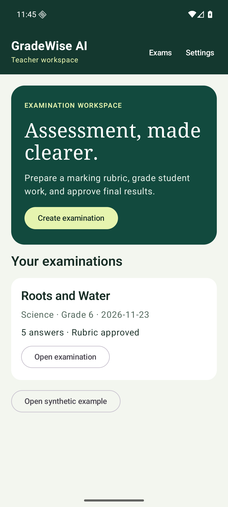

# GradeWise AI for Android

The native Kotlin and Compose app stores examinations and grading queues in app-private local storage. An approved grading pack is available offline. Gemini Nano grading requires a supported physical Android device with the AICore model ready. Firebase AI Logic uses the Gemini Developer API for rubric preparation and cloud grading. The synthetic example supports teacher review and CSV export without Firebase configuration.

## Build and test

Install JDK 21, Android SDK Platform 36, and Android platform tools. Set ANDROID_HOME to the SDK directory. On this Mac that directory is /opt/homebrew/share/android-commandlinetools.

```sh
cd apps/android
./gradlew testDebugUnitTest assembleDebug
adb install -r app/build/outputs/apk/debug/app-debug.apk
./gradlew connectedDebugAndroidTest
```

The Compose test opens the synthetic exam, enters a teacher score, and checks the results screen. An instrumented document test uses generated PNG and image-only PDF fixtures. The unit tests cover evidence, score totals, consent, disagreement, offline routing, blank answers, numbered parsing, and CSV safety. Use a test emulator for connectedDebugAndroidTest because Gradle may uninstall the app after the tests.

## Connect Firebase

1. Register an Android app with package name app.gradewise.android in your Firebase project. Enable Firebase AI Logic with the Gemini Developer API and enforce App Check.
2. Place the Firebase client configuration at app/google-services.json. The app can build without this ignored file for teacher-only use.
3. Run a debug build and use Settings to make a synthetic test request. Find the debug token locally in Logcat and register it in Firebase App Check. Keep debug tokens out of screenshots, transcripts, and version control.
4. Register Play Integrity and the release signing SHA-256 before distributing a production build. Debug App Check is compiled only into the debug variant.
5. For live verification, install the test APK alongside the app with the registered token. Run the desired test with ADB to preserve app data. Use a supported physical device and a ready Gemini Nano model for the on-device check. Disconnect the test device before running the local-inference or offline-recovery tests.

```sh
./gradlew assembleDebugAndroidTest
adb install -r app/build/outputs/apk/androidTest/debug/app-debug-androidTest.apk
adb shell am instrument -w -e firebaseAppCheckSmoke true -e firebaseSmoke true app.gradewise.android.test/androidx.test.runner.AndroidJUnitRunner
adb shell am instrument -w -e firebaseLocalSmoke true app.gradewise.android.test/androidx.test.runner.AndroidJUnitRunner
adb shell am instrument -w -e firebaseOfflineSmoke true app.gradewise.android.test/androidx.test.runner.AndroidJUnitRunner
```

The demo cloud project is intended for synthetic or non-sensitive material. Imports accept UTF-8 TXT, PDFs, JPEG and PNG. GradeWise reads PDF text locally and uses a bundled ML Kit model to read images and image-only PDFs. Correct the preview against the original before continuing, especially for handwriting or mixed scanned and selectable PDF pages. Batch import uses a question ID and colon at the start of each answer. On-device availability can be checked from Settings.

## Verification on November 23, 2026

- The debug APK installed and opened on an Android 16 emulator. The unsigned release build and release lint passed.
- All nine JVM tests passed. Three instrumented checks passed in airplane mode, covering teacher review, local OCR for PNG and image-only PDF, and unresolved cloud-only grading.
- A finalized teacher score and approved synthetic exam remained available after a cold process restart.
- The Android SDK exchanged the registered App Check debug secret for a signed token against Firebase.
- The emulator reported Gemini Nano unavailable. Gemini on-device inference requires compatible physical hardware, and live cloud Gemini requests await project activation.

- [Firebase AI Logic Android hybrid setup](https://firebase.google.com/docs/ai-logic/hybrid/android/get-started)
- [Android App Check debug provider](https://firebase.google.com/docs/app-check/android/debug-provider)
- [Gemini Developer API pricing](https://aistudio.google.com/docs/pricing#gemini-3.5-flash-lite)
- [Play Integrity provider](https://firebase.google.com/docs/app-check/android/play-integrity-provider)


